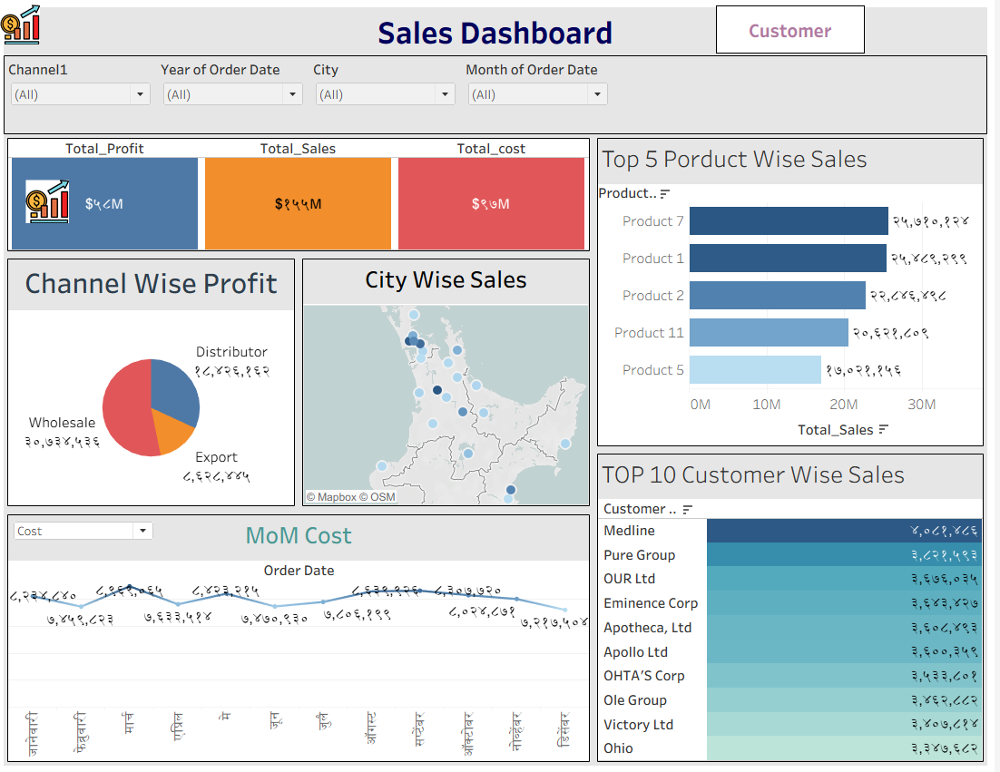

# 📊 Sales Performance Dashboard | Tableau

## 📌 Project Overview
This project showcases an interactive Sales Performance Dashboard created using Tableau.

The dashboard analyzes business sales data to identify revenue trends, profitability, customer performance, product contributions, and geographic sales distribution.

## 🛠️ Tools & Technologies
- Tableau
- Microsoft Excel (Data Source)
- Calculated Fields
- Data Visualization
- Interactive Filters
- Business Intelligence Reporting

## 🎯 Project Objectives
- Monitor overall sales, profit, and cost.
- Identify the top 5 products by sales.
- Analyze channel-wise profitability.
- Compare geographic sales performance.
- Track month-over-month business trends.
- Identify the top 10 customers by revenue.

## 📊 Key Performance Indicators
The dashboard displays:
- Total Profit
- Total Sales
- Total Cost

These KPIs provide a quick overview of business performance.

## 📈 Dashboard Features

### 1. KPI Summary
- Displays total profit, total sales, and total cost.
- Provides an overview of business performance.

### 2. Top 5 Product-Wise Sales
- Horizontal bar chart ranking the five leading products.
- Helps identify major revenue-generating products.

### 3. Channel-Wise Profit
- Pie chart showing profit distribution across:
  - Wholesale
  - Distributor
  - Export

### 4. City-Wise Sales
- Geographic map showing sales distribution.
- Helps identify sales concentration across locations.

### 5. Month-over-Month Analysis
- Line chart displaying monthly business trends.
- Metric selection for performance comparison.
- Helps identify fluctuations and seasonal patterns.

### 6. Top 10 Customer-Wise Sales
- Ranked bar chart showing leading customers.
- Helps identify customers contributing the most revenue.

## 🔍 Interactive Filters
The dashboard supports filtering by:
- Sales Channel
- Order Year
- City
- Order Month

## 💡 Key Insights
- Product 7 and Product 1 ranked among the top-selling products.
- Wholesale contributed the highest share of channel-wise profit.
- Sales performance varied across geographic locations.
- Monthly cost trends showed fluctuations throughout the year.
- The top 10 customer chart highlights key revenue contributors.

## 🖼️ Dashboard Preview

## 📁 Project Structure

Tableau-Sales-Analysis-Dashboard/
├── README.md
├── tableau-sales-dashboard.png

## 🚀 Conclusion
This project demonstrates hands-on skills in Tableau dashboard development, calculated fields, business KPI reporting, geographic analysis, and interactive data visualization.

The dashboard helps businesses monitor sales performance, identify valuable customers, and make data-driven decisions.
